<!--
  github.com/itsubaidullahomer/itsubaidullahomer — renders on my GitHub profile page.

  The activity / work / now blocks (between the start/end marker comments) are
  rewritten every morning by scripts/build.mjs via .github/workflows/update.yml.
  Edit anything outside those markers freely; edits inside them get overwritten.
  Products live in data/products.json.
-->

# Ubaidullah

**Product engineer.** I build AI products people rely on.

Pakistan · Remote · Available for select work

---

<!-- activity:start -->
<picture>
  <source media="(prefers-color-scheme: dark)" srcset="assets/activity-dark.svg">
  
</picture>

<b>1,967 contributions</b> in the last 12 months — 1,960 on GitLab, 7 on GitHub. Nearly all of my commits go to Tututor.ai's private repos on GitLab, which is why the GitHub graph further down looks empty. This card merges both and rebuilds itself every morning — <a href="scripts/build.mjs">source</a>.
<!-- activity:end -->

I'm a product engineer in Pakistan. Most of what I build has an LLM somewhere behind it.

Right now that's **[Tututor.ai](https://tututor.ai)**, where around **17,000 students and teachers** in Murcia, Spain use it every day. I'm responsible for the AI services, the school CRM and the student-facing app.

Four years of building web apps. I started as a junior and ended up owning the architecture and most of the AI work — from the data model to the last CSS fix.

## Selected work

All of these are live, with real users on them — and this page checks that every day.

<!-- work:start -->
| | Project | What it is | Built with |
| :-: | :--- | :--- | :--- |
|  | **[Tututor.ai](https://tututor.ai)** | Education platform for schools in Spain. AI tutors teachers can shape per topic, quiz generation with automatic grading, per-class analytics, school CRM. | React · Node · Express · MongoDB · WebSockets · OpenAI · ElevenLabs |
|  | **[Illume](https://www.joinillume.com/)** | Business analytics for MedSpas that builds its own dashboards from whatever data you connect. Started as Insight-X. | React · Tailwind · Chart.js · D3 |
|  | **[Viloi](https://viloi.com)** | A writing tool that rewrites machine-generated text so it reads naturally. Multi-model pipeline, Stripe billing — built solo. | React · Node · Express · MongoDB · Stripe |
|  | **[Yaksport](https://yaksport.dk/)** | Booking platform for Danish sports clubs looking for training camps abroad. Over 100 clubs use it. | React · Tailwind · i18next · React Router |

Status is checked once a day by <a href=".github/workflows/update.yml">a workflow in this repo</a>, not hand-typed. Last check Sep 7, 2026, 15:52 UTC · uptime since Sep 7, 2026: 100%.
<!-- work:end -->

→ **[Case studies and the full list](https://itsubaidullahomer.com)**

## Now

<!-- now:start -->
Mirrored from <a href="https://itsubaidullahomer.com/now">itsubaidullahomer.com/now</a> · last updated May 13, 2026

**Shipping**
- Scaling Tututor past 17k users, mostly on the teacher tools. The goal is to make lesson prep boring, in a good way.
- Reworking the AI chatbot session model so teachers can review student conversations more efficiently.

**Learning**
- Going deeper on streaming and tool use with Anthropic's API.
- Reading about evals. Getting from 'it answered' to 'it answered well' turns out to be a different problem.

**Side**
- This site. I mostly built it to work out how to explain what I do.
<!-- now:end -->

## What I work with

| | |
| :--- | :--- |
| **Frontend** | React · Next.js · TypeScript · Tailwind · Framer Motion · Redux Toolkit |
| **Backend** | Node.js · Express · MongoDB · WebSockets · Microservices |
| **AI** | OpenAI API · Claude · ElevenLabs · streaming, multi-model pipelines |
| **Rest of it** | Stripe · Vercel · Chart.js / D3 · i18next |

## How I think about the work

**Ship it, then keep it running.** Building a demo and keeping a product alive are different jobs.

**The prompt is rarely the hard part.** Most of the work in an AI feature goes into the streaming, the shape you store things in, the failure modes and the latency budget.

**Design is part of the job.** Most of my work has been at startups with no designer on the team, so I got used to thinking about the flow before the components.

**Speed is part of the product.** I'll spend time on the bundle, the queries and the layout shift, because people feel a slow page even when they can't say why.

---

**Have something worth building?**

I'm looking at a small number of product and AI engineering roles.
If you're building something people already use, I'd like to hear about it.

**[Start a conversation →](https://itsubaidullahomer.com)**

